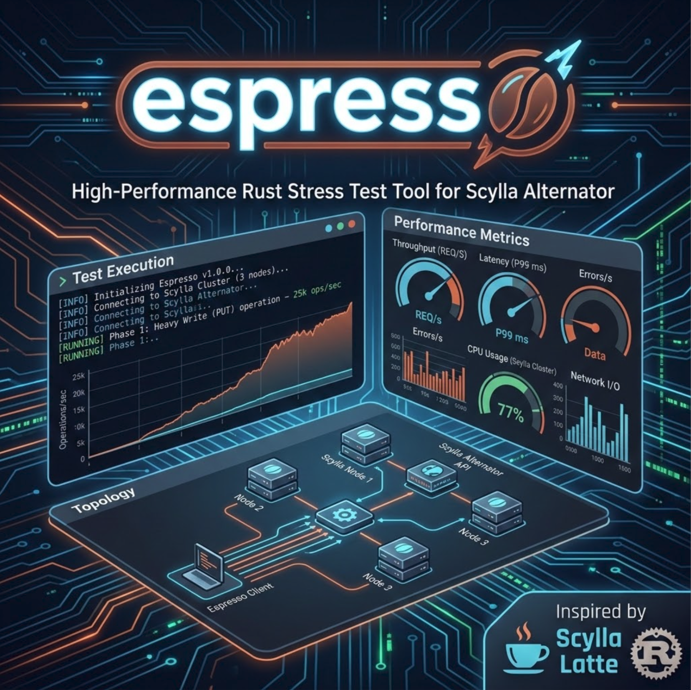

# espresso



High-throughput stress testing tool for Scylla workloads using either:
- [ScyllaDB Alternator](https://docs.scylladb.com/stable/alternator/alternator.html) (DynamoDB-compatible API)
- Native Scylla CQL protocol

Inspired by [latte](https://github.com/pkolaczk/latte), espresso keeps workload definitions declarative in YAML while applying high-throughput execution techniques from Latte.

---

## Motivation

Latte stress-tests Scylla via CQL. Alternator users need equivalent tooling for the DynamoDB protocol layer — measuring real-world latency and throughput as seen by DynamoDB SDK clients.

Espresso now supports both backends:
- Alternator for DynamoDB-compatible API testing
- Native CQL for Scylla protocol benchmarking with the same declarative YAML workflow

---

## Planned Features

### Core

- **Workload execution** — run configurable read/write/mixed workloads against Alternator
- **Async, high-concurrency** — Tokio-based async runtime, tunable concurrency level
- **Multi-node targeting** — `round_robin` (per-request) or `node_affinity` (per-worker pinned) across Alternator nodes
- **Connection pooling** — per-node HTTP connection reuse via `hyper` keep-alive

### Workload Operations

- `PutItem` — write single items
- `GetItem` — point reads by primary key
- `BatchWriteItem` — bulk writes
- `BatchGetItem` — bulk reads
- `Query` — partition-level range queries
- `Scan` — full table scan (load generation)
- `UpdateItem` — conditional updates
- `DeleteItem` — targeted deletes

### Schema Management

- Auto table creation with configurable partition key / sort key
- Configurable item size (payload bytes)
- Configurable key cardinality / distribution (uniform, Zipf)

### Metrics & Reporting

- Latency percentiles: p50, p99, p999, max
- Throughput: ops/sec, rows/sec
- Error rate tracking (throttling, timeouts, retries)
- Live progress output during run
- Final report summary (text + JSON)
- Histogram output compatible with HDR Histogram

### Configuration

- YAML/TOML config file for workload definition
- CLI flags for quick runs
- Seed data phase (populate before stress)
- Warmup phase (excluded from metrics)
- Duration-based or operation-count-based runs

### Data Generation Model (planned)

Espresso aims to keep workload files declarative by letting users specify generator intent while espresso handles internal expression logic.

Supported generator styles (initial target):
- `uniform(start..end)`
- `sequential(start..end)`
- `zipf(start..end, s)`
- Fixed-size payload generation for binary/string attributes

Range behavior:
- `sequential(1..100)` emits `1,2,3,...,100,1,2,...` (cycles by default)
- If generated rows exceed range cardinality, duplicates are expected by design
- This enables realistic duplicate-heavy and cache-friendly workloads

Example semantics:
- `sequential(1..100)` with 1000 generated rows produces values repeating across `1..100`
- `uniform(1..1000000)` spreads accesses evenly across that keyspace
- `zipf(1..1000000, 1.2)` skews access toward a hot subset

Configuration goals:
- No user-facing expression strings for common patterns
- Per-table and per-operation generator overrides
- Per-attribute size controls (for example payload bytes on `val`)
- Deterministic replay support via seedable RNG (planned)

### Compatibility

- Any DynamoDB-compatible endpoint (Scylla Alternator, AWS DynamoDB, DynamoDB Local)
- Configurable AWS region / dummy credentials for non-AWS targets
- TLS support for production clusters

---

## Non-Goals

- Shard-aware routing for Alternator (not possible over HTTP/DynamoDB protocol)
- Full DynamoDB feature parity (focus on stress patterns, not SDK completeness)

---

## Comparison: espresso vs latte

| Feature | latte (CQL) | espresso (Alternator) |
|---|---|---|
| Protocol | CQL binary | DynamoDB HTTP REST |
| Shard-aware | Yes | No |
| Transport | TCP native | HTTP/1.1 |
| Target | Scylla/Cassandra | Scylla Alternator / AWS DynamoDB |
| Scripting | Rune scripts | YAML workload definitions |

---

## CQL Quick Start

```bash
# Run CQL profile against local Scylla
cargo run --release -- run --profile espresso_profiles/cql_key_value.yml

# Override nodes for a cluster
cargo run --release -- run --profile espresso_profiles/cql_key_value.yml \
  --nodes node1:9042,node2:9042,node3:9042

# Use schema command only (creates keyspace/tables if configured)
cargo run --release -- schema --profile espresso_profiles/cql_key_value.yml

# Run with throttle and sinusoidal variation
cargo run --release -- run --profile espresso_profiles/cql_key_value.yml \
  --throttle 10000 --throttle-sine-amplitude 0.2 --throttle-sine-period 60s
```

CQL profile specifics:
- Set `target.kind: cql`
- Use CQL nodes as `host:port` (for example `10.0.0.12:9042`)
- Configure `target.cql.keyspace`, `connections_per_shard`, and optional `local_dc`
- Reuse the same phase, generator, mix, and reporting model as Alternator

---

## Quick Start (planned)

```bash
# Create table and populate with 1M items
espresso populate --nodes http://node1:8000,http://node2:8000 --items 1000000

# Run mixed 80/20 read/write workload for 60 seconds
espresso run --nodes http://node1:8000,http://node2:8000 \
  --workload mixed --read-ratio 0.8 \
  --concurrency 256 --duration 60s
```

## Current CLI (implemented)

Performance note:
- Use release builds for realistic benchmark numbers: `cargo run --release -- run --profile ...`
- Debug builds add extra checks and lower optimizations, which inflate latency and reduce throughput.

```bash
# ── Default profile (no YAML required) ─────────────────────────────────────

# Run built-in key/value profile against localhost:8000
espresso run

# Run default profile against a real cluster
espresso run --nodes http://node1:8000 --nodes http://node2:8000 --nodes http://node3:8000

# Apply schema for the default key/value table against a cluster
espresso schema --nodes http://node1:8000,http://node2:8000

# ── Typical workflow: populate then benchmark ───────────────────────────────

# Step 1 — populate 500k rows
espresso run --nodes http://node1:8000,http://node2:8000,http://node3:8000 \
  --phase populate --rows 500000

# Step 2 — mixed 80/20 read/write against those rows for 60 seconds
espresso run --nodes http://node1:8000,http://node2:8000,http://node3:8000 \
  --phase benchmark --rows 500000 --duration 60s

# Step 3 — pure write stress for 2 minutes
espresso run --nodes http://node1:8000,http://node2:8000,http://node3:8000 \
  --phase write_only --rows 500000 --duration 2m

# Step 4 — pure read stress for 2 minutes
espresso run --nodes http://node1:8000,http://node2:8000,http://node3:8000 \
  --phase read_only --rows 500000 --duration 2m

# ── Rows and duration flags ─────────────────────────────────────────────────

# --rows sets the keyspace size (row_count and populate_operation_count)
# --duration overrides the run length for any duration-mode phase

# Larger keyspace, shorter run
espresso run --nodes http://node1:8000 --phase benchmark \
  --rows 5000000 --duration 30s

# Adaptive throttle targeting p99 ≤ 5ms with a 1M row working set
espresso run --nodes http://node1:8000 --phase read_only \
  --rows 1000000 --duration 120s --target-p99-ms 5

# ── Custom profile ──────────────────────────────────────────────────────────

# Run all phases from an Alternator profile
espresso run --profile espresso_profiles/key_value.yml

# Run all phases from a CQL profile
espresso run --profile espresso_profiles/cql_key_value.yml

# Override variables at runtime
espresso run --profile espresso_profiles/key_value.yml \
  --var cache_hit_ratio=95 --var row_count=5000000

# Override target nodes from CLI even with a custom profile
espresso run --profile espresso_profiles/key_value.yml \
  --nodes http://node1:8000,http://node2:8000

# Limit total phase throughput (shared across all workers)
espresso run --profile espresso_profiles/key_value.yml --throttle 2000

# Disable throttling explicitly (run as fast as possible)
espresso run --profile espresso_profiles/key_value.yml --throttle 0

# Run only one phase by name
espresso run --profile espresso_profiles/key_value.yml --phase populate

# Run one phase with throttle
espresso run --profile espresso_profiles/key_value.yml \
  --phase run_read_heavy --throttle 2000

# Adaptive throttle to target p99 latency (milliseconds)
espresso run --profile espresso_profiles/key_value.yml \
  --phase run_read_heavy --target-p99-ms 25

# Adaptive mode with an explicit starting throttle
espresso run --profile espresso_profiles/key_value.yml \
  --phase run_read_heavy --throttle 1000 --target-p99-ms 25

# Apply schema only
espresso schema --profile espresso_profiles/key_value.yml
```

Rows and duration notes:
- `--rows N` sets `row_count` and `populate_operation_count` to N; controls the keyspace size for all phases.
- `--duration <time>` overrides the run length for any `duration`-mode phase (e.g. `30s`, `5m`, `2h`).
- Both flags work with the default profile and with `--profile`.

Throttle notes:
- `--throttle` is a phase-wide cap in operations/second.
- Positive values cap throughput; `0` disables throttling.
- Omitted `--throttle` is equivalent to unlimited.
- With `--target-p99-ms`, omitted `--throttle` uses an auto default starting rate.

Adaptive p99 notes:
- `--target-p99-ms <ms>` enables runtime throttle control to converge toward the requested p99.
- Controller adjusts throttle every second using recent observed latency.
- This is best-effort: if the system is capacity-bound, achieved p99 may remain above target.

Phase notes:
- `--phase <name>` runs only the matching phase from the profile.
- If omitted, espresso runs all phases in order.

## Execution Model Notes

For each phase:
- `threads` controls worker task count.
- `concurrency` controls per-worker in-flight requests.
- Effective parallelism is approximately `threads * concurrency`.

Alternator target execution mode:

```yaml
target:
  kind: alternator
  nodes:
    - http://node1:8000
    - http://node2:8000
  node_execution_mode: node_affinity  # round_robin | node_affinity
```

- `round_robin`: each request selects the next endpoint.
- `node_affinity`: each worker uses one endpoint chosen by `worker_id % node_count`.

## Composite Key and Batch Setup

Espresso now auto-handles both single-key and composite-key tables at runtime.

What this means:
- If a table has only a partition key, Espresso sends that key as usual.
- If a table has partition key + sort key, Espresso automatically sends both keys for:
  - `get_item`
  - `delete_item`
  - `update_item`
  - `batch_get_item`
  - `put_item`
  - `batch_write_item`
- Key names and key types (`N`, `S`, `B`) are taken from `tables[].key_schema`.

Minimal composite-key table example:

```yaml
tables:
  - name: orders
    billing_mode: pay_per_request
    key_schema:
      partition_key:
        name: customer_id
        type: N
      sort_key:
        name: order_ts
        type: N
    attributes:
      - name: customer_id
        type: N
      - name: order_ts
        type: N
      - name: val
        type: B
        size_bytes: 256
```

Composite-key phase with batch ops:

```yaml
phases:
  - name: batch_rw
    mode: duration
    duration: 120s
    concurrency: 128
    warmup: 10s
    include_in_metrics: true
    table_operations:
      - table: orders
        mix:
          batch_get_item: 0.5
          batch_write_item: 0.5
        operation_templates:
          batch_get_item:
            keys:
              - strategy: uniform
                key_field: customer_id
              - strategy: uniform
                key_field: order_ts
          batch_write_item:
            items:
              - strategy: generated_from_vars
                key_field: customer_id
                value_field: val
```

Batch sizing:
- `batch_get_item`: batch size defaults to 25 if `keys` is omitted; otherwise uses `keys` list length.
- `batch_write_item`: batch size defaults to 25 if `items` is omitted; otherwise uses `items` list length.
- Batch size is clamped to `1..100`.

Scenario-ready sample profiles:
- Fixed rows-per-partition window: `espresso_profiles/composite_fixed_rows.yml`
- Variable rows-per-partition window: `espresso_profiles/composite_variable_rows.yml`

Run examples:

```bash
# Fixed logical 35-row window per partition
espresso run --profile espresso_profiles/composite_fixed_rows.yml --phase populate
espresso run --profile espresso_profiles/composite_fixed_rows.yml --phase read_write

# Variable logical window per partition in [1, 100]
espresso run --profile espresso_profiles/composite_variable_rows.yml --phase populate
espresso run --profile espresso_profiles/composite_variable_rows.yml --phase read_write

# Override keyspace and distribution from CLI
espresso run --profile espresso_profiles/composite_variable_rows.yml \
  --phase read_write --var row_count=50000 \
  --var rows_per_partition_min=5 --var rows_per_partition_max=90
```

Important behavior note:
- `rows_per_partition` and `rows_per_partition_min/max` control the active logical sort-key window per partition.
- Exact on-disk uniqueness still depends on your key/sort_key generator strategy and operation mix.
- For deterministic repeatable key windows, use bounded `range: [min, max]` with `sequential` generators.

Sort-key range and rows-per-partition controls:
- Use `range: [min, max]` on key generators for simpler bounded keyspace definitions.
- For composite-key tables, you can control how many sort-key rows each partition can have:
  - Fixed per partition: set `vars.rows_per_partition`.
  - Random per partition: set `vars.rows_per_partition_min` and `vars.rows_per_partition_max`.
- Row counts are computed per partition key, so some partitions can be small while others are large.

String formatting for `S` attributes:
- Use optional `prefix` and `suffix` in generator configs.
- Works for partition keys, sort keys, and non-key string value fields.
- Ignored for `N` and `B` attributes.

Examples:

```yaml
# Partition key: customer-1, customer-2, ...
key:
  strategy: sequential
  key_field: customer_id
  range: [1, 1000]
  prefix: "customer-"

# Sort key: ts-1-v1, ts-2-v1, ...
sort_key:
  strategy: sequential
  key_field: order_ts
  range: [1, 1000]
  prefix: "ts-"
  suffix: "-v1"

# Non-key value field: payload-<generated>
item:
  strategy: uniform
  key_field: customer_id
  value_field: payload
  prefix: "payload-"
```

Example: variable rows per partition with bounded sort key range

```yaml
vars:
  row_count: 100000
  rows_per_partition_min: 1
  rows_per_partition_max: 100

phases:
  - name: read_write
    mode: duration
    duration: 60s
    concurrency: 128
    warmup: 10s
    include_in_metrics: true
    table_operations:
      - table: orders
        mix:
          get_item: 0.7
          put_item: 0.3
        operation_templates:
          get_item:
            key:
              strategy: uniform
              key_field: customer_id
              range: [1, 100000]
            sort_key:
              strategy: uniform
              key_field: order_ts
              range: [1, 100]
          put_item:
            item:
              strategy: uniform
              key_field: customer_id
              value_field: val
              range: [1, 100000]
            sort_key:
              strategy: uniform
              key_field: order_ts
              range: [1, 100]
```

## Operation Configuration Guides

Detailed operation-specific configuration docs are available under `docs/`:

- [Profile Configuration Reference](docs/config-reference.md)
- [Profile Cookbook](docs/cookbook.md)
- [Operation Docs Index](docs/README.md)
- [CQL Backend Guide](docs/cql-backend.md)
- [PutItem Guide](docs/operations-put-item.md)
- [GetItem Guide](docs/operations-get-item.md)
- [BatchWriteItem Guide](docs/operations-batch-write-item.md)
- [BatchGetItem Guide](docs/operations-batch-get-item.md)
- [Query Guide](docs/operations-query.md)
- [Scan Guide](docs/operations-scan.md)
- [UpdateItem Guide](docs/operations-update-item.md)
- [DeleteItem Guide](docs/operations-delete-item.md)

---

## Alternator Compatibility Reference

> Source: [ScyllaDB Alternator Compatibility](https://docs.scylladb.com/manual/stable/alternator/compatibility.html)
> Last reviewed: 2026-05-01

This section documents what Alternator supports, what it doesn't, and where it diverges from DynamoDB. Critical for knowing which espresso workloads are valid targets.

---

### Supported Operations

| Operation | Notes |
|---|---|
| `GetItem` | Full support |
| `PutItem` | Full support |
| `DeleteItem` | Full support |
| `UpdateItem` | Full support, incl. conditional updates |
| `BatchGetItem` | Full support |
| `BatchWriteItem` | Limit **100 items** (DynamoDB: 25) |
| `Query` | Full support |
| `Scan` | Full support |
| `CreateTable` | Full support |
| `DeleteTable` | Full support |
| `UpdateTable` | Full support |
| `ListTables` | Full support |
| `DescribeTable` | Partial — see caveats below |
| `DescribeEndpoints` | Supported |
| `ListTagsOfResource` | Supported |
| `TagResource` / `UntagResource` | Supported |
| `DescribeTimeToLive` | Supported |
| GSI / LSI | Supported |
| TTL expiration | Supported, configurable delay (default 24h) |
| Authentication (access key / secret) | Supported |
| Authorization (CQL GRANT/REVOKE) | Supported |
| DynamoDB Streams | **Experimental** — must enable explicitly |

---

### Unsupported Operations

These must **not** be used in espresso workloads.

**Transactions:**
- `TransactWriteItems`, `TransactGetItems` — not implemented

**Global Table Management:**
- `CreateGlobalTable`, `UpdateGlobalTable`, `DescribeGlobalTable`, `ListGlobalTables`
- Note: all Alternator tables are inherently global across DCs — these APIs are unnecessary

**Backup & Recovery:**
- `CreateBackup`, `DeleteBackup`, `ListBackups`, `RestoreTableFromBackup`
- `UpdateContinuousBackups`, `DescribeContinuousBackups`, `RestoreTableToPointInTime`

**Kinesis Integration:**
- `EnableKinesisStreamingDestination`, `DisableKinesisStreamingDestination`, `DescribeKinesisStreamingDestination`

**S3 Import/Export:**
- `ExportTableToPointInTime`, `DescribeExport`, `ListExports`
- `ImportTable`, `DescribeImport`, `ListImports`

**PartiQL / SQL-like Interface:**
- `ExecuteStatement`, `BatchExecuteStatement`, `ExecuteTransaction`

**Monitoring APIs:**
- `DescribeContributorInsights`, `UpdateContributorInsights`, `ListContributorInsights`

**Recent DynamoDB Additions (not yet in Alternator):**
- `TableClass` (Dec 2021)
- `DeletionProtectionEnabled` (Mar 2023)
- `WarmThroughput` (Nov 2024)
- `MultiRegionConsistency` (Dec 2024)
- Multi-attribute composite keys in GSIs (Nov 2025)

**Other:**
- DAX (DynamoDB Accelerator) — N/A, Scylla has its own caching
- Encryption-at-rest via DynamoDB API (available via Scylla config, not API)

---

### Partial Support & Caveats

**DynamoDB Streams (Experimental)**
- Must enable: `--experimental-features=alternator-streams`
- Only works with vnodes — tablets require tag `system:initial_tablets=none`
- ~10 second delay vs. DynamoDB's sub-second
- `eventSource` = `"scylladb:alternator"` (not `"aws:dynamodb"`)
- Single `PutItem` appears as `REMOVE + MODIFY` events (not `INSERT`)
- More shards than DynamoDB streams
- `ShardFilter` parameter not implemented

**Write Isolation — Important for Stress Testing**
- Must configure write isolation policy explicitly
- `always_use_lwt` = safest, uses Paxos, **significantly slower**
- Non-LWT writes can reorder if NTP not synchronized across nodes
- Clock collision risk: two writes at same microsecond → mixed result
- **espresso implication**: test both LWT and non-LWT modes, report which is in use

**DescribeTable**
- Missing: `IndexSizeBytes`, `ItemCount` estimates
- Index info may be incomplete
- Data can lag up to 6 hours (configurable)

**Load Balancing**
- Not built into Alternator — must use external load balancer or client-side round-robin
- **espresso implication**: multi-node flag is essential; single-node targets will bottleneck

---

### Alternator vs DynamoDB Behavioral Differences

| Dimension | DynamoDB | Alternator |
|---|---|---|
| Provisioning | RCU/WCU per table | Node sizing; no per-table cap |
| `BatchWriteItem` limit | 25 items | 100 items (configurable) |
| Table name max length | 255 chars | **192 chars** |
| GSI + LSI name total | 255 chars | **222 chars** |
| TTL expiration SLA | < 48 hours | Configurable, default 24h |
| Scan ordering | Proprietary hash | Cassandra Murmur3 hash |
| All tables | Single-region unless Global Table | Always globally replicated across DCs |
| Billing mode | PROVISIONED or PAY_PER_REQUEST | Always PAY_PER_REQUEST equivalent |
| Authorization model | IAM / `PutResourcePolicy` | CQL `GRANT` / `REVOKE` |
| Monitoring | CloudWatch | Prometheus + Grafana |

---

### CQL Authorization Mapping (for cluster setup docs)

Alternator permissions map to CQL operations on keyspace `alternator_[table]`:

| DynamoDB Action | CQL Permission |
|---|---|
| Read (GetItem, Query, Scan) | `SELECT` |
| Write (PutItem, UpdateItem, DeleteItem) | `MODIFY` |
| CreateTable | `CREATE` |
| DeleteTable | `DROP` |
| UpdateTable | `ALTER` |

Table name mapping:
- Base table: `alternator_[table].[table]`
- Index: `alternator_[table].[table]:[index]`

---

## Status

Early development. Features subject to change.
